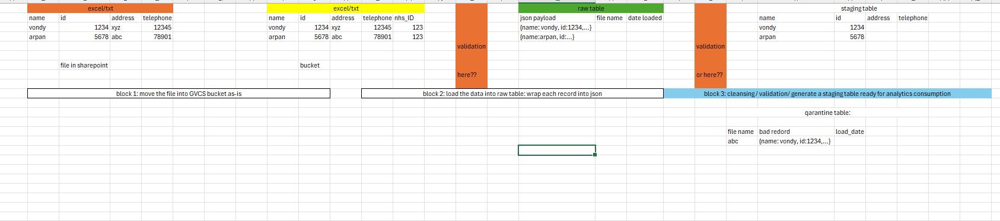

# Raw JSON tables vs contract validation

*Written 2026-10-14. Compares the raw-JSON ingestion pattern proposed
in [`upcoming_work.md`](upcoming_work.md) with py-common's current
approach, first for small monthly Excel feeds, then for a large daily
feed.*

## The question

The proposal is to load every data file into a raw BigQuery table,
with each row stored as JSON, so a change in a file's columns doesn't
stop the load. Validation and cleaning would happen later, when
building a staging table for analysis:

The diagram leaves open where validation should sit: before the raw
table, or after it. The two claims made for the JSON approach are:

1. It uses fewer resources.
2. It doesn't fail on data issues.

## How each approach works

- **Raw JSON** (see [`upcoming_work.md`](upcoming_work.md)): a Cloud
  Run service reads each file with every value as text. It appends
  each row to one raw BigQuery table as a JSON `payload` column,
  alongside `source_file`, `source_generation`, `row_number` and
  `ingested_at`. A Dataform assertion then compares the JSON keys
  against the expected columns, and a Dataform model extracts the
  values into a flat table.
- **py-common**: each workbook is checked against a contract before
  anything reaches BigQuery. The contract lists the required sheets,
  columns, data types, which columns may be empty and which must be
  unique ([`contract.py`](../src/py_common/contract.py)). Files that
  pass are converted to Parquet, loaded into a staging table,
  row-counted, then merged into a typed final table. That merge and
  the audit record are written in a single transaction
  ([`bigquery.py`](../src/py_common/adapters/bigquery.py)). Files
  that fail are copied to a `quarantine/` folder in the bucket and
  never reach BigQuery ([`pipeline.py`](../src/py_common/pipeline.py)).

---

## Part 1: small monthly feeds (3 tables, 1–50 rows a month each)

- **Volume:** at most about 150 rows a month, roughly 1,800 a year.
  That is kilobytes of data.
- **Schema changes:** none expected, but one could happen by accident
  in any month (a renamed or added column, or a changed data type),
  which would break the data visualisation further down the pipeline.

### Checking the two claims

**"JSON uses fewer resources."** At this scale it doesn't matter.

- Both approaches will almost certainly cost nothing. BigQuery batch
  loads are free, and the free tier covers 10 GB of storage and 1 TB
  of queries a month. Each pipeline runs only a few small queries a
  month.
- At large scale JSON is usually *more* expensive to query. BigQuery
  can skip typed columns a query doesn't need, but reading any field
  from a JSON column scans the whole column.
- The real cost is people's time. The JSON approach needs Cloud Run,
  Pub/Sub, Eventarc and Dataform set up, plus the validation
  rewritten in SQL. py-common's validation is already built and
  tested.

**"JSON doesn't fail on data issues."** It doesn't fail *at load
time*, but the problem still has to be caught later.

- **If the Dataform assertion is in place:** it fails, and the
  cleaned table isn't refreshed. The pipeline still stops, one step
  later.
- **If the assertion is missing or incomplete:** a renamed column
  comes out as NULL for every row, and the visualisation quietly
  shows blanks or wrong totals. This is the worst outcome.
- Because the example loader reads every value as text, a wrong data
  type (e.g. "N/A" in a number column) isn't detected until a SQL
  cast fails or silently returns NULL.

### Pros and cons

| | Raw JSON table | py-common (validate first, typed tables) |
|---|---|---|
| **Cost at ~150 rows/month** | About £0 | About £0 |
| **Accidental schema change** | Loads anyway. Caught later by the Dataform assertion, or not caught at all | File rejected at the start with a clear message, e.g. `Missing column 'telephone'` |
| **Wrong data type / blank required field** | Not checked at load (everything is text). Must be handled with casts in SQL | Caught per row, with row numbers in the error |
| **Is the bad month's data kept?** | Yes, in BigQuery, so it can be queried | Yes, as the original file in the GCS `raw/` and `quarantine/` folders, but not in BigQuery |
| **Effect on the visualisation** | Out of date if the assertion stops the refresh. Silently wrong if the assertion misses something | Out of date (last good month) until the file is fixed. Never silently wrong |
| **Who finds out, and when** | Whoever looks at Dataform's assertion failures, possibly days later | The file owner can be told immediately with exact errors, once alerting is added (see below) |
| **Deduplication / reloads** | Each new version of a file is appended; the SQL keeps only the latest version | Exact repeat files are skipped by checksum. Rows are updated by key columns, so no duplicates |
| **Audit trail** | Load job logs only | Audit record written in the same transaction as the data |
| **Effort to build** | New Cloud Run service, Eventarc, Dataform repository, SQL checks for each table | Mostly built already. Needs one contract per table |
| **Copes with frequent or deliberate schema changes** | Very well, which is its main strength | Poorly: every change means editing the contract |
| **Best fit** | Many sources, frequently changing schemas, large volumes, unknown suppliers | Few sources, stable schemas, small volumes, a known file owner who can fix files |

### Where validation should sit

Validate at both points marked in the diagram, but give each a
different job:

1. **Before BigQuery: the main check.** This is py-common's contract.
   Catching a bad file here means the file owner can fix it while
   they still remember the change. With 50 rows, fixing it in Excel
   and re-uploading is quick.
2. **Before the visualisation: a light safety check.** The point is
   to protect the visualisation, not to repeat the contract. Check
   that this period's data arrived, that row counts look reasonable
   and that key fields aren't empty. A simple SQL check or a Dataform
   assertion would do.

### Recommendation: py-common, plus a hybrid

- **Keep py-common's typed tables and the contract check at the
  start.**
- **Add alerts when a file is quarantined.** At the moment a
  quarantined file triggers no alert (see "Validation errors
  quarantine, not fail" in [`DECISIONS_en.md`](../DECISIONS_en.md)).
  A monthly file that gets quarantined could leave the visualisation
  out of date with nobody knowing. This is the most important
  addition.
- **Optionally, also load every file into a raw JSON table, including
  quarantined ones.** That keeps everything queryable in BigQuery,
  with the typed tables still built only from files that passed.
  Since the original files are already kept in GCS, this is a
  nice-to-have.
- **Optionally, accept extra columns but ignore them.** Today an
  extra column, such as someone adding a "notes" column, rejects the
  whole file. This would need a small change to the contract code.

### Gaps in py-common to check first

- **Only the first worksheet is loaded.** Every worksheet listed in
  the contract is validated, but only the first one is converted and
  loaded (`Pipeline._to_parquet`). If several tables share a
  workbook, use one contract per sheet, with that sheet listed first.
- **An integer column with a blank cell may fail at the merge.**
  pandas would likely turn that column into decimals, and BigQuery
  won't insert decimals into an INT64 column. This hasn't been run
  yet; test it with the `events_missing_value` fixture against a
  nullable integer column.
- **The final tables are not created by the code.** The final
  BigQuery tables have to be created with their schema beforehand.

---

## Part 2: a large daily feed (6 million rows a day)

At this scale the answer reverses. py-common in its current form
won't cope, and a raw-JSON-style design starts to pay for itself.
Cost matters, but how the tables are designed affects it far more
than the choice between JSON and typed columns.

### Where py-common breaks

- **Excel can't hold that much.** A worksheet holds at most 1,048,576
  rows, so this data would arrive as CSV or similar, or as several
  files. py-common's contract check only reads Excel.
- **It's slow and memory-hungry.** The workbook is loaded fully into
  memory, then parsed a second time to create the Parquet file.
  Validation checks each cell in a Python loop, and pandas then
  builds a 6M-row table in memory. Expect very long runs and many GB
  of memory, if it fits at all.
- **One bad row rejects the whole file.** With 50 rows a month,
  fixing a file by hand is quick. With 6M rows a day, a few bad rows
  are almost certain every day, and nobody can hand-fix the file.
  Nearly every day's data would be quarantined.
- **The merge cost keeps growing.** The MERGE into the final table
  reads the whole final table each run, and that table would grow by
  about 2 billion rows a year. Without partitioning, every daily run
  gets more expensive.

### Rough costs

These assume about 20 columns, roughly 200 bytes per row as typed
columns, and new rows each day (not a full snapshot): about 1.2 GB a
day, or 440 GB a year. Prices are approximate BigQuery list prices:
about $6.25 per TB scanned by queries and about $0.02 per GB per
month for storage.

| | Typed columns | JSON payload |
|---|---|---|
| **Storage after 1 year** | ~440 GB ≈ $9/month | Roughly 2–3× larger, because column names repeat in every row: ≈ $20–25/month |
| **Daily processing, partitioned and incremental** | Scans about one day of data: pennies | Same idea, a few GB a day: pennies |
| **Daily processing, full rebuild or unpartitioned MERGE** | Scans the whole table every day: hundreds of $ in year 1, rising each year | Worse, because reading any field reads the whole JSON column |

The costly choice is reprocessing the full history every day, not
JSON versus typed columns. If the tables are partitioned by load date
and only the new day's rows are processed, either option costs very
little.

### What the JSON approach gets right at this scale

- **It records the bad rows and loads the rest.** The diagram's
  quarantine table holds individual bad records. That is the right
  design with 6M rows a day: good rows go through, bad rows are set
  aside with the reason, and the day isn't lost.
- **Validation in SQL is fast.** Checking 6M rows with SQL in
  BigQuery takes seconds; doing it row by row in Python takes a long
  time.
- **Columns are matched by name.** JSON keys are names, so columns in
  a different order still land in the right place. BigQuery CSV loads
  usually match columns by position, so a reordered file could load
  values under the wrong column names without any error. (BigQuery
  may now support name matching for CSV loads; not yet confirmed.)

### Recommended design for the large feed

1. **Check the header row before loading.** Reading the first line of
   the file is cheap. If columns are missing, renamed or unexpected,
   stop and alert before 6M rows are loaded. This is the large-scale
   version of py-common's contract check.
2. **Load the raw data with BigQuery itself.** Run a BigQuery load
   job straight from the GCS file into a raw table partitioned by
   load date. Avoid building Python row objects as in the example in
   [`upcoming_work.md`](upcoming_work.md); 6M of them could use many
   GB of memory in Cloud Run. The raw table can store each row as
   JSON, or as all-text columns, which are cheaper to query.
3. **Validate rows in SQL and split them.** Process the new partition
   only. Rows that pass go into a typed, partitioned cleaned table.
   Rows that fail go into the quarantine table with the file name,
   the reason and the load date, as in the diagram.
4. **Set a threshold.** If more than a set share of rows fail (say
   1%), don't publish that day; alert instead. A sudden jump in
   failures usually means a schema or upstream problem, not a few bad
   rows.
5. **Run a light check before the visualisation**, as for the small
   feeds: today's data arrived, row counts look normal, and key
   fields aren't empty.

### What this means for py-common

One approach doesn't have to fit every feed:

- **Small Excel feeds:** py-common as it is, plus quarantine alerts.
- **Large feeds:** reuse py-common's outer parts if useful: finding
  source files, skipping repeats by checksum, keeping the original
  file, the audit trail and the run lock. Replace the middle steps
  (Excel parsing, Python validation and the unpartitioned MERGE) with
  steps 1–4 above.

The large-feed numbers rest on the assumptions above. To firm them
up, confirm the feed's file format, the number of columns, and
whether each day brings new rows or a full refreshed copy.
