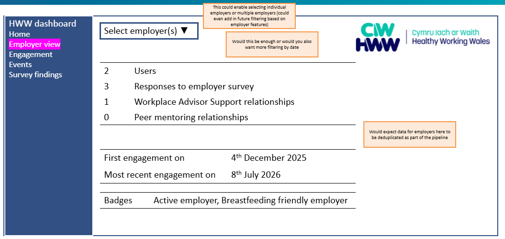
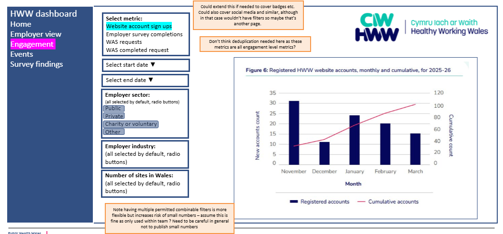
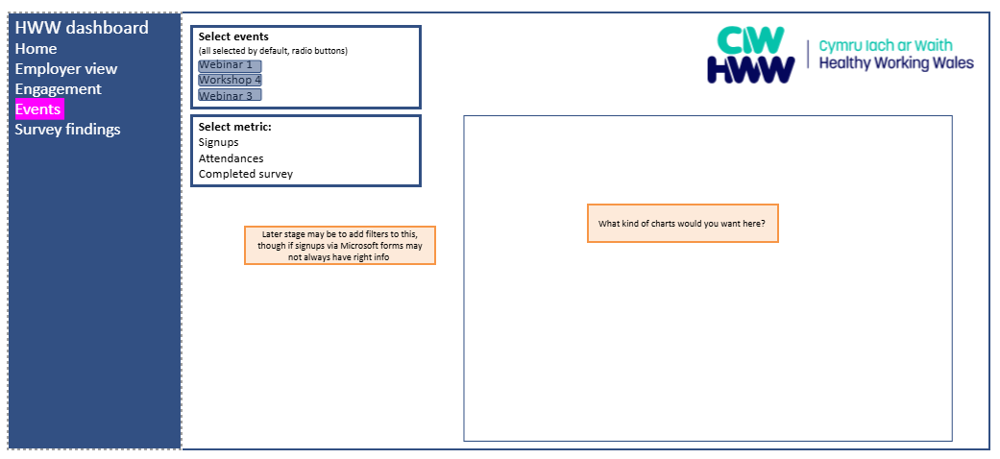
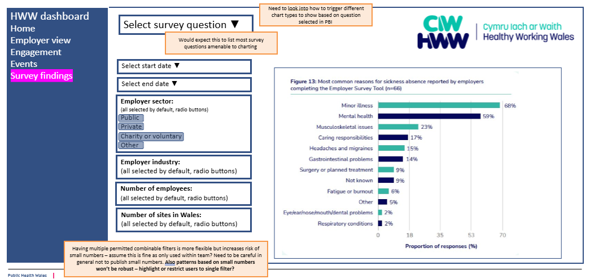

# How to: set up Cloud Run to move data that lands in a GCS bucket

> **Archived prototype.** This is the earlier CSV-to-BigQuery design,
> kept for reference. It predates py-common's GCS source and raw JSON
> route and doesn't describe how they behave (for example, it reads
> the object's current bytes rather than the event's generation). For
> the maintained set-up, follow `docs/GCP_SETUP.md`.

Please note that this may be superseded by future work using Terraform. In particular, steps relating to the creation of Docker image and Cloud Run service are expected to be further automated. 

TODO: also want to update this pipeline to use the table-per-table strategy, not the single table strategy (see Patterns: ingestion framework). 

## Objective 

As part of our data ingestion pipelines, we use the following pattern: 

- data lands in a GCS bucket 
- we do something with it using Cloud Run. In this illustration, the thing we do will be to move it into BigQuery with columns stored in json format. 

## Prerequisites / assumptions

- Access to a project where you can create GCS buckets and Big Query tables. In the commands, this is `<DATA_PROJECT_ID>`. 
- Access to a project where you can run apps using a service account. In the commands, this is `<APP_PROJECT_ID>` and the service account is `<SERVICE_ACCOUNT_EMAIL>`. 
- We will assume you have already created the following: 
  - A GCS bucket in the data project to collect raw data, referred to as `<RAW_BUCKET_NAME>`. Remember you can create this using Terraform from the terraform-page

## Permissions 

For this you will need at least the following permissions: 

- pubsub.topics.create
- pubsub.topics.get
- pubsub.topics.publish
- pubsub.topics.getIamPolicy
- storage.buckets.update (applying to `<RAW_BUCKET_NAME>` in `<DATA_PROJECT_ID>`)

Speak to the Data Engineering team to get these set up. 

## Further reading 

This pipeline is based on [Google's tutorial on routing events across Google Cloud projects](https://docs.cloud.google.com/eventarc/docs/cross-project-triggers#storage-events). 


### About Cloud Run 

[Google's own guide to Cloud Run](https://docs.cloud.google.com/run/docs/overview/what-is-cloud-run) is the primary resource. It contains a useful flow diagram to decide what to use depending on use case.

Broadly, you can work with Cloud Run services, which are triggered by a request in some form, and Cloud Run jobs, which correspond to a task and may be triggered manually or scheduled. 

You may come across the idea of Cloud Run functions (formerly Cloud Functions). Cloud Functions seem to have largely been absorbed into the broader Cloud Run stable, and are no longer pushed as a separate topic in documentation. A very minimal Cloud Run service (which can scale to zero) provides the functionality covered by functions. 

Within the Cloud Run stable, there are also instances (continuously running) and worker pools (designed to pull from a queue), but we have not had to use these currently. 

In this guide, we are using Cloud Run services. 

There are many ways to set up a Cloud Run service. You can provide a Docker container, provide code from a repo, or provide code directly inline. However, whichever way you provide the code, under the hood Google is using a Docker container: the only difference is who creates the container. In this guide, we will create the container ourselves.

## Step by step

The idea is: 

- Data lands in GCS bucket 
- Triggers a JSON message to a Pub Sub topic 
- Pub Sub topic feeds into a Cloud Run function via Eventarc. This passes the Cloud Run function the information about the data location in the bucket. 
- The Cloud Run function carries out your action 

The following sections use `gcloud`. You should be able to run them either: 

- locally using the `gcloud` CLI, or
- on GCP directly using Cloud Shell. 

### Configuration

Before running the commands, replace **every value in angle brackets** in this configuration block. 

```bash
APP_PROJECT="<APP_PROJECT_ID>" # CHANGE THIS: Google Cloud project that hosts Cloud Run and Pub/Sub
DATA_PROJECT="<DATA_PROJECT_ID>" # CHANGE THIS: Google Cloud project that hosts the GCS bucket
RAW_BUCKET="<RAW_BUCKET_NAME>" # CHANGE THIS: existing bucket in the data project
TOPIC="<PUBSUB_TOPIC_NAME>" # CHANGE THIS: Pub/Sub topic name
IMAGE="<IMAGE_NAME>" # CHANGE THIS: container image name
SERVICE="<CLOUD_RUN_SERVICE_NAME>" # CHANGE THIS: Cloud Run service name
SA="<SERVICE_ACCOUNT_EMAIL>" # CHANGE THIS: service account email
BQ_TABLE="<BQ_PROJECT_ID>.<DATASET_ID>.<TABLE_ID>" # CHANGE THIS: destination table
ARTIFACT_REGISTRY_REPOSITORY="<ARTIFACT_REGISTRY_REPOSITORY>" # CHANGE THIS: Artifact Registry repository name - note that for 
# this you may choose to use an existing repository
```

### Create Pub Sub topic based on uploads to bucket

```
gcloud config set project "$DATA_PROJECT"
gcloud storage buckets notifications create "gs://$RAW_BUCKET" --topic="projects/$APP_PROJECT/topics/$TOPIC" --payload-format=json
```

### Create the destination table in Big Query

```bash
bq query --use_legacy_sql=false \
  "CREATE TABLE IF NOT EXISTS \`${BQ_TABLE}\` (source_file STRING, source_generation STRING, row_number INT64, ingested_at TIMESTAMP, payload JSON)"
```


### Prepare the code for the application and Docker image

Work in the app project: `gcloud config set project "$APP_PROJECT"`

Identify the code you want to deploy as part of the container. For now we will: 

- assume the code can be written in Python
- copy it manually across into the relevant structure. However, we expect to replace this section with at least cloning directly from GitHub and eventually automatic building and upload of the Docker container directly from GitHub side.

Create the code in the following structure: 

- a `main.py` file, containing a function with the code you want to run (we will assume this is called `process_file`). The function should be decorated using the `functions_framework` package as shown below.
- a `requirements.txt` file, containing `functions-framework`, `google-cloud-storage`, `google-cloud-bigquery`, and `pandas`, plus any other packages used by your application.
- a Dockerfile (`Dockerfile` - no extension). An example is given below.

#### Minimal main.py example

This example expects each CSV file to have a header row. It supports different headers and column counts between files by storing each row as a JSON object in the `payload` column. CSV values are stored as strings. Metadata identifying the source of the row is also stored.

As Eventarc can redeliver events, leading to duplication, a load job ID is also derived from the object generation. Redeliveries of the same object reuse the same job so should not generate additional rows.

Logging info calls are included. These will appear in the main logs.  

```python
import base64
import hashlib
import json
import logging
import os
from datetime import datetime, timezone
from io import StringIO

import functions_framework
import pandas as pd
from google.api_core.exceptions import Conflict
from google.cloud import bigquery, storage

logging.basicConfig(level=logging.INFO)

@functions_framework.cloud_event
def process_file(event):
  notification = json.loads(
    base64.b64decode(event.data["message"]["data"])
  )
  bucket_name = notification["bucket"]
  object_name = notification["name"]
  logging.info("Processing source object gs://%s/%s", bucket_name, object_name)

  csv_text = storage.Client().bucket(bucket_name).blob(object_name).download_as_text()
  logging.info("Downloaded source object gs://%s/%s (%d characters)", bucket_name, object_name, len(csv_text))
  dataframe = pd.read_csv(StringIO(csv_text), dtype=str, keep_default_na=False)
  logging.info("Parsed CSV with %d rows and %d columns", len(dataframe), len(dataframe.columns))
  source_file = f"gs://{bucket_name}/{object_name}"
  generation = str(notification["generation"])
  ingested_at = datetime.now(timezone.utc).isoformat()
  rows = [
    {
      "source_file": source_file,
      "source_generation": generation,
      "row_number": row_number,
      "ingested_at": ingested_at,
      "payload": row,
    }
    for row_number, row in enumerate(dataframe.to_dict(orient="records"), start=1)
  ]
  logging.info("Prepared %d rows for BigQuery", len(rows))

  job_key = f"{bucket_name}/{object_name}#{generation}"
  job_id = "csv_" + hashlib.sha256(job_key.encode()).hexdigest()
  client = bigquery.Client()
  table = client.get_table(os.environ["BQ_TABLE"])
  job_config = bigquery.LoadJobConfig(
    write_disposition=bigquery.WriteDisposition.WRITE_APPEND
  )
  try:
    logging.info("Submitting BigQuery load job %s to %s", job_id, table.full_table_id)
    job = client.load_table_from_json(
      rows,
      table,
      job_id=job_id,
      location=table.location,
      job_config=job_config,
    )
  except Conflict:
    logging.info("BigQuery load job %s already exists; waiting for its result", job_id)
    job = client.get_job(job_id, location=table.location)
  try:
    job.result()
  except Exception:
    logging.exception("BigQuery load job %s failed for %s", job_id, source_file)
    raise
  logging.info("BigQuery load job %s completed for %s", job_id, source_file)
```

#### Dockerfile example

```dockerfile
FROM python:3.14-slim

WORKDIR /app
COPY requirements.txt .
RUN pip install --no-cache-dir -r requirements.txt
COPY . .

# CHANGE THIS target if the handler in main.py has a different name.
CMD ["functions-framework", "--target=process_file", "--signature-type=cloudevent", "--port=8080"]
```

### Build the Docker image 

Build the image. Artifact Registry repository creation can be skipped if you're using an existing repository.

```bash
IMAGE_URI="europe-west2-docker.pkg.dev/$APP_PROJECT/$ARTIFACT_REGISTRY_REPOSITORY/$IMAGE"

gcloud config set project "$APP_PROJECT"
gcloud artifacts repositories create "$ARTIFACT_REGISTRY_REPOSITORY" \
  --repository-format=docker \
  --location="europe-west2" \
  --description="Cloud Run images"

docker build -t "$IMAGE_URI" .
gcloud auth configure-docker "europe-west2-docker.pkg.dev"
docker push "$IMAGE_URI"
```

### Deploy the Cloud Run service

Deploy in the app project and configure the service to run as a service account with permission to read objects from the source bucket and insert rows into the destination BigQuery dataset. Pass the destination table to the service through the `BQ_TABLE` environment variable.

```bash
gcloud run deploy "$SERVICE" \
  --image "$IMAGE_URI" \
  --region "europe-west2" \
  --service-account "$SA" \
  --set-env-vars "BQ_TABLE=$BQ_TABLE" \
  --no-allow-unauthenticated
```

### Set up the Eventarc trigger

Create an Eventarc trigger for messages published to the Pub/Sub topic. The trigger service account needs the Eventarc Event Receiver and Cloud Run Invoker roles; it also needs any permissions required by the application if it is the same account used to run the service.

```bash
gcloud eventarc triggers create "$TOPIC-eventarc-trigger" \
  --location="europe-west2" \
  --destination-run-service="$SERVICE" \
  --destination-run-region="europe-west2" \
  --event-filters="type=google.cloud.pubsub.topic.v1.messagePublished" \
  --transport-topic="projects/$APP_PROJECT/topics/$TOPIC" \
  --service-account="$SA"
```


# Patterns: ingestion framework

This page describes patterns you can use as part of a data ingestion framework. 

It was first written as part of the Healthy Working Wales data migration, and may evolve further as patterns evolve. The Healthy Working Wales data is fairly typical in that it consists of several different data sources, which need to have some data cleaning, manipulation and aggregation as part of the pipeline. 

Broadly, we're breaking this pipeline into: 

1. Landing zone: 
   1. Get the data onto GCP in Cloud Storage Buckets
   2. No processing at this stage 
   3. Query: should we reject files in incorrect formats at this stage via a Cloud Run script? 
2. Raw (bronze)
   1. Get the data into raw tables in Big Query 
   2. We have set up the tables with as columns:
      1. source_file: name of file data came from 
      2. source_generation: generation to keep track of data with revisions
      3. row_number: row number in source data 
      4. ingested_at: ingestion timestamp 
      5. payload: actual data in row in JSON format. By formatting it like this this pipeline is flexible to source data changes. Validation of columns happens later. 
3. Silver:
   1. Do validation, deduplication, cleaning and so on
   2. Data that has reached silver  should be ready-to-analyse
4. Gold: 
   1. Data ready to consume 
   2. Additional processing such as joining, summarising and so on
5. User-facing views 

For stages 3 and 4 the tech stack is up for discussion. Options include: 

- Dataform where possible - Dataform is GCP-native way to stitch together SQL manipulations. Keeping data manipulation steps in SQL should make them more efficient. 
- Cloud Run to run Python or R if needed 


## Patterns for multiple data tables 

If the source data has multiple underlying tables, there are different options for how to process it: 

- single table strategy: get all the data into a single raw table, then separate it again at the silver stage 
- table-per-table strategy: have a raw table in BQ for each individual table

While the single table strategy has the minimum overhead in terms of initial setup (for example, minimal table provisioning), it is conceptually messier and 
we therefore propose the table-per-table strategy. 


Dataform is a tool for developing and orchestrating SQL transformations in BigQuery. You define models in SQLX files, and Dataform manages their dependencies and runs them in the right order.

## Why use Dataform?

SQL is really powerful and efficient. But beyond a couple of queries, it becomes hard to manage things like dependencies between files and keep track of what's going on. 

Dataform solves this problem: it gives a structured way to define SQL-based workflows, and also supports features like data checks along the way.

If you've come across dbt, Dataform is essentially a Google equivalent. 

## Key concepts

Core concepts for using Dataform are:

- Models: SQL files that define the tables or views to create in BigQuery. A model can be a staging table, transformed table, or final reporting table.
- SQLX: Dataform uses SQLX files, which are SQL files with extra metadata for declarations, dependencies, and configuration.
- Dependencies: Dataform infers the relationships between models from references in SQL, so it knows the correct execution order. You can also visualise this through the platform.
- Assertions: You can add tests or assertions to validate that data meets expected conditions before it is published or consumed downstream.
- Workflows: A workflow is the set of models, assertions, and schedules that make up a transformation pipeline.
- Environments and execution: Dataform runs the transformations in BigQuery using a defined execution flow. 
- Development workspaces: In GCP, a Dataform workspace is a developer's isolated working copy of a Git branch in the repository (you may not have specified it explictly as a git repository, but it is one under the hood). You can make and test changes there without affecting the shared code. Committing changes in Dataform creates Git commits on that branch, which you can push to the default branch. Production runs use the code specified by the release configuration and workflow, not uncommitted workspace changes.

## Example workflow

The scripts below illustrate a fairly minimal Dataform workflow, as an example. 

They take as input a BigQuery table with the structure described in the [Cloud Run data-movement script](how-to-setup-cloudrun-to-move-data.md). They then:

- check that the columns appearing in the JSON rows are as expected (that is: examplecol1, examplecol2, examplecol3)
- filter to only data from the most recent update of the source file

To start implementing the workflow: 

- You will need an input BigQuery table. Specifically, for the demo this should have the structure described as the output of [Cloud Run data-movement script](how-to-setup-cloudrun-to-move-data.md). That is, it contains columns for source_file, ingested_at (timestamp of ingestion), source_generation (generation of source file) and payload (with data from each row in JSON format). Rows in the payload columns have columns examplecol1, examplecol2, examplecol3 (specified in JSON).
- Go to Dataform in GCP in the same project as the input BigQuery table 
- Click 'Create repository'. Give your repo a name, set region to europe-west2, set the service account to run with (TODO: decode what is recommended here), and click Create.
- Within your repository click 'Create development workspace' and navigate to it (under the hood this is effectively creating a Git branch to work on and an associated workspace for you to work in, though you don't seem to really have to think about this!).
- Now you can start adding files. 

The repository we will create has the following structure:

```text
my_dataform_project/
├── includes/ # this folder is for .js files with shared config, but we're not using it in the example
├── definitions/ # this folder is for models 
│   ├── sources.sqlx
│   ├── filter_and_unpack.sqlx
|   └── assertions/ # this subfolder is for checks 
|       └── validate_columns.sqlx
├── workflow_settings.yaml
└── .gitignore
```

You can either create this manually file-by-file or by editing the default example initialisation. Note you will need to edit the files wherever they contain "TODOs". 

Specifically, `sources.sqlx` contains: 

```{sql}
-- This is for specifying the data source that we will reference in other scripts
config {
  type: "declaration",
  project: TODO_PUT_YOUR_PROJECT_NAME_HERE,
  schema: TODO_PUT_YOUR_SCHEMA_NAME_HERE,
  name: TODO_PUT_YOUR_INPUT_TABLE_NAME_HERE
}
```

`validate_columns.sqlx` contains: 

```{sql}
-- This is an example SQLX file to check columns are as expected.
-- It's on dummy data with fake column names for now.
-- It only checks the latest generation for each source file name to
-- allow data to be fixed if issues in earlier data. 
config {
  type: "assertion"
}

WITH latest_generations AS (
SELECT
source_file,
MAX(source_generation) AS source_generation
FROM ${ref("TODO_PUT_YOUR_INPUT_TABLE_NAME_HERE")}
GROUP BY source_file
),
latest_data AS (
SELECT r.*
FROM ${ref("TODO_PUT_YOUR_INPUT_TABLE_NAME_HERE")} r
JOIN latest_generations g
USING (source_file, source_generation)
),

actual_keys AS (
  SELECT DISTINCT key
  FROM latest_data,
  UNNEST(JSON_KEYS(payload)) AS key
),

expected_keys AS (
  SELECT 'examplecol1' AS key UNION ALL
  SELECT 'examplecol2' UNION ALL
  SELECT 'examplecol3'
)

SELECT 'unexpected' AS issue, key
FROM actual_keys
WHERE key NOT IN (SELECT key FROM expected_keys)

UNION ALL

SELECT 'missing' AS issue, key
FROM expected_keys
WHERE key NOT IN (SELECT key FROM actual_keys)
```

`filter_and_unpack.sqlx` contains: 

```{sql}
-- Unpack data:
-- For each source file name in the data, filter only the latest update of this
-- Unpack the json col into the table 

config {
  type: "table",
  description: "Flattened payload from raw landing table",
  dependencies: ["validate_columns"],
  columns: {
    examplecol1: "Example 1",
    examplecol2: "Example 2",
    examplecol3: "Example 3"
  }
}

WITH latest_generations AS (
SELECT
source_file,
MAX(source_generation) AS source_generation
FROM ${ref("TODO_PUT_YOUR_INPUT_TABLE_NAME_HERE")}
GROUP BY source_file
),
latest_data AS (
SELECT r.*
FROM ${ref("TODO_PUT_YOUR_INPUT_TABLE_NAME_HERE")} r
JOIN latest_generations g
USING (source_file, source_generation)
)
SELECT
  JSON_VALUE(payload, '$.examplecol1') AS examplecol1,
  JSON_VALUE(payload, '$.examplecol2') AS examplecol2,
  JSON_VALUE(payload, '$.examplecol3') AS examplecol3,
  source_generation AS source_generation,
  ingested_at AS ingestion_timestamp, 
  source_file AS source_file
FROM latest_data
```

`workflow_settings.yaml` contains:

```{yaml}
defaultProject: TODO_PUT_YOUR_PROJECT_NAME_HERE
defaultDataset: TODO_PUT_YOUR_SCHEMA_NAME_HERE
defaultAssertionDataset: TODO_PUT_YOUR_SCHEMA_NAME_HERE
dataformCoreVersion: 3.0.52
```

Note that 'ref' allows you to call things from elsewhere in the workflow. In general they will have the name of the file, unless name was a specified field (as in sources.sqlx).

Next steps are: 

- Click "Run" to try running a particular script.
- When you're done making changes, on the left of the screen click "Commit", leave a message about what changed, and click "Push to default branch" (note this will just be within this repository on GCP for now - we've not set up the repo to be on GitHub, and to do so would need to check what we're disclosing). 
- At the top of the screen, click "Compiled graph" to see the overall workflow and dependencies. 
- Then click "Start execution" to run the whole workflow. You may need to request permissions to be able to do this. 
- In the future, you might [schedule execution or execute based on triggers](https://docs.cloud.google.com/dataform/docs/schedule-runs), rather than executing manually. 








